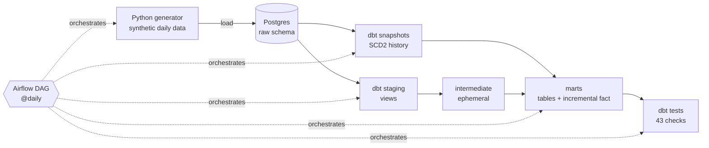
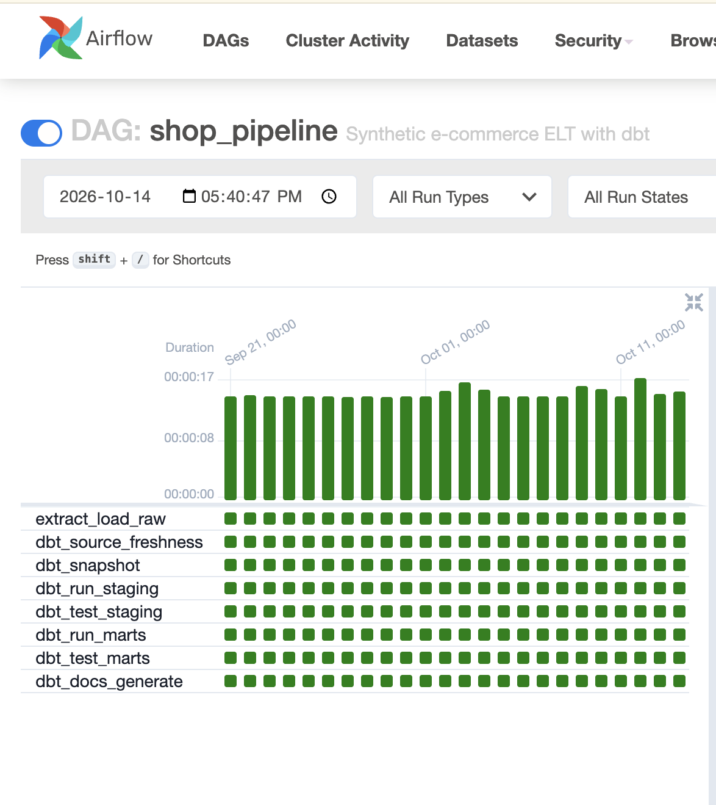
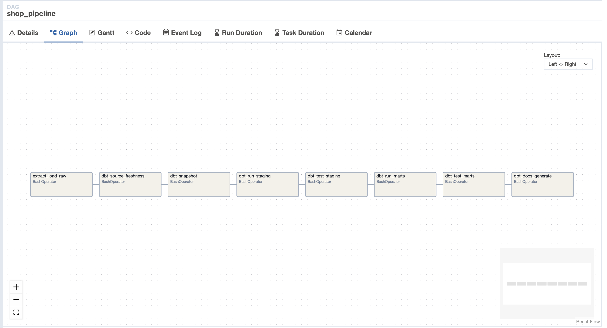
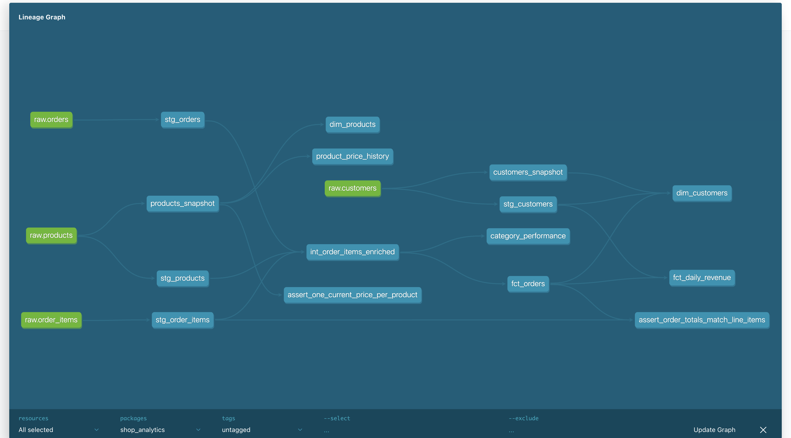
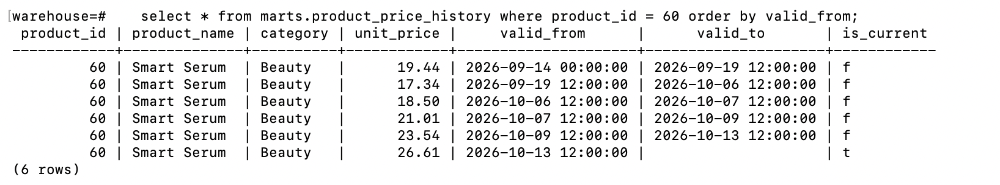

# E-commerce ELT Pipeline with Airflow + dbt

An end-to-end, containerised ELT pipeline. **Apache Airflow** orchestrates a daily load of
synthetic e-commerce data into **PostgreSQL**, and **dbt** transforms it into tested,
documented analytics tables, including **SCD Type 2 history** with dbt snapshots and an
**incremental** fact table. Every change is checked by **GitHub Actions CI**.

## Architecture



## Screenshots

**Airflow: 30-day backfill, every task green**


**Airflow DAG**


**dbt lineage: sources → staging → marts, plus snapshots**


**SCD Type 2: a product's full price history from dbt snapshots**


## Design decisions

- **Idempotent loads.** The loader deletes and reloads a day's orders, so Airflow retries
  and backfills never create duplicates.
- **Ordered backfills.** `max_active_runs=1` makes days run in sequence, because snapshots
  must see changes in the order they happened to build correct history.
- **Tests gate the marts.** Staging tests run before marts are built, so bad source data
  stops the pipeline instead of reaching reports. `--indirect-selection cautious` keeps
  cross-layer tests from running too early.
- **Incremental fact table.** `fct_orders` reprocesses only a 3-day window
  (`delete+insert` on `order_id`), which catches late updates without full rebuilds.
- **Two snapshot strategies.** Products use `timestamp` (the source has a reliable
  `updated_at`); customers use `check` on `loyalty_tier` (shows the alternative when
  timestamps can't be trusted).
- **dbt in its own virtualenv** inside the Airflow image to avoid dependency conflicts.

### Airflow DAG: `shop_pipeline`

`extract_load_raw → dbt_source_freshness → dbt_snapshot → dbt_run_staging → dbt_test_staging → dbt_run_marts → dbt_test_marts → dbt_docs_generate`

- Runs `@daily`, with **catchup** that backfills 30 days of history on first start
- `max_active_runs=1` keeps backfill runs in order (required for correct snapshots)
- Retries on failure; the loader is **idempotent** (rerunning a day replaces it, never duplicates)
- Tests are split by layer: bad staging data stops the run **before** marts are rebuilt

### dbt project: `shop_analytics`

| Layer | Models | Materialisation |
|---|---|---|
| Staging | `stg_customers`, `stg_products`, `stg_orders`, `stg_order_items` | view |
| Intermediate | `int_order_items_enriched` | ephemeral |
| Snapshots | `products_snapshot` (timestamp strategy), `customers_snapshot` (check strategy) | SCD2 table |
| Marts | `fct_orders` (incremental, delete+insert), `dim_customers`, `dim_products`, `product_price_history`, `fct_daily_revenue`, `category_performance` | table |

Also included:
- **43 data tests**: unique, not_null, accepted_values, relationships, a custom generic test (`positive_value`), and singular tests (order totals reconcile to line items; exactly one current snapshot row per product)
- **Source freshness** checks on raw orders
- **Macros**: `cents_to_dollars`, custom `generate_schema_name`
- Model and column **documentation** (`dbt docs`)

The generator deliberately produces messy data (inconsistent email casing and whitespace,
upper-case statuses, missing channels) so the staging layer does real cleaning.

## Run it locally

**Prerequisites:** [Docker Desktop](https://www.docker.com/products/docker-desktop/) and Git.

```bash
git clone https://github.com/vikramdata/dbt-airflow-pipeline.git
cd dbt-airflow-pipeline
docker compose up -d --build
```

1. Wait about 1–2 minutes, then open **http://localhost:8080** (login `admin` / `admin`).
2. Switch on the `shop_pipeline` DAG with the toggle. Airflow starts backfilling 30 days.
3. Click into the DAG to watch the runs in the Grid and Graph views.

Query the results with any SQL client (DBeaver, pgAdmin, VS Code) on
`localhost:5433`, database `warehouse`, user and password `postgres`:

```sql
select * from marts.fct_daily_revenue order by order_date;
select * from marts.product_price_history where product_id = 1 order by valid_from;
select customer_segment, count(*) from marts.dim_customers group by 1;
```

To stop: `docker compose down`. To wipe all data as well: `docker compose down -v`.

## Run dbt without Docker (optional)

```bash
pip install -r requirements.txt
cd dbt
export DBT_PROFILES_DIR=.      # Windows PowerShell: $env:DBT_PROFILES_DIR="."
export DBT_PORT=5433           # pointing at the Docker Postgres
python ../scripts/generate_data.py --date 2026-10-01
dbt build
dbt docs generate && dbt docs serve   # browse the lineage graph
```

## Project structure

```
├── dags/shop_pipeline.py          # Airflow DAG
├── dbt/
│   ├── models/staging|intermediate|marts
│   ├── snapshots/                 # SCD2 history
│   ├── macros/                    # cents_to_dollars, positive_value test, schema naming
│   ├── tests/                     # singular data tests
│   ├── dbt_project.yml
│   └── profiles.yml               # reads connection details from env vars
├── scripts/generate_data.py       # synthetic data loader
├── docker/init-db.sql             # creates airflow + warehouse databases
├── Dockerfile                     # Airflow image + dbt in its own virtualenv
├── docker-compose.yml
└── .github/workflows/dbt-ci.yml   # dbt build on every push / PR
```

## Possible extensions

- Render each dbt model as its own Airflow task with Astronomer Cosmos
- Swap Postgres for Snowflake, BigQuery, or Redshift by changing `profiles.yml`
- Add a Metabase container and dashboard on top of the marts
- Publish `dbt docs` to GitHub Pages
